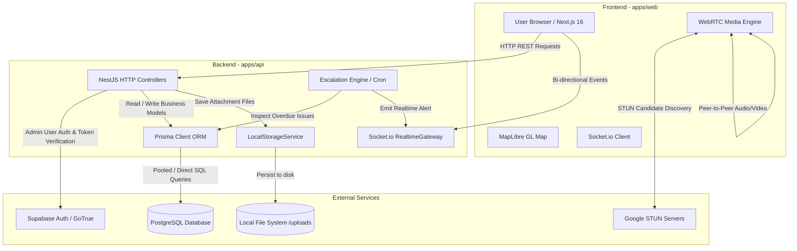
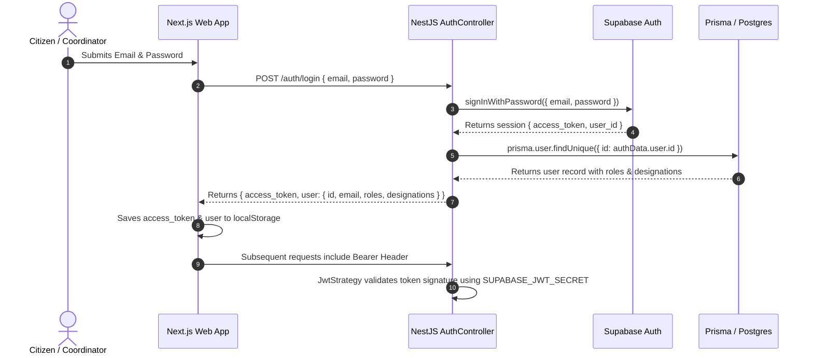
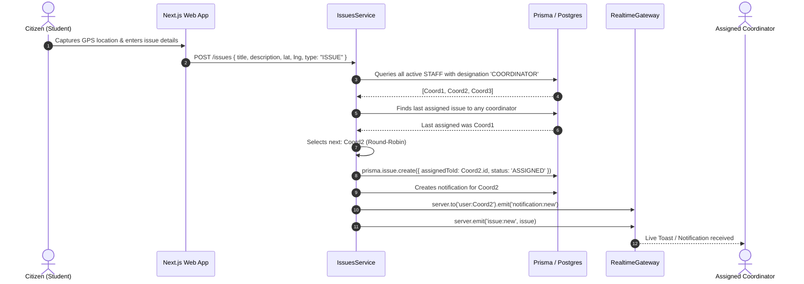

# System Architecture

## 1. High-Level Architectural Overview

The system is architected as a **monorepo-decoupled client-server application**, utilizing an event-driven and RESTful hybrid architecture. 

- **Frontend (`apps/web`):** Next.js 16 App Router application functioning as a rich Single Page Application (SPA). Provides real-time interactive mapping, WebRTC media streaming, and dynamic dashboard views.
- **Backend (`apps/api`):** NestJS 12 enterprise framework providing typed controllers, domain services, WebSocket gateways, and background scheduled tasks.
- **Data & Auth Tier:** PostgreSQL hosted via Supabase, managed using Prisma ORM. Supabase GoTrue Auth handles identity creation and authentication sessions, while Prisma models business data, relationships, and audit logs.

---

## 2. Major Backend Modules (`apps/api/src`)

| Module | Primary Responsibility | Key Files |
| :--- | :--- | :--- |
| **`AuthModule`** | Supabase authentication integration, user registration, JWT generation & verification. | `auth.controller.ts`, `auth.service.ts`, `jwt.strategy.ts` |
| **`IssuesModule`** | Issue CRUD, round-robin auto-assignment, status state transitions, file attachment handling. | `issues.controller.ts`, `issues.service.ts` |
| **`RealtimeModule`** | Socket.io gateway, room subscriptions (`user:*`, `role:*`, `managers_of:*`, `all_locations`), location relay, WebRTC signaling. | `realtime.gateway.ts`, `ws-auth.guard.ts` |
| **`EscalationModule`** | Scheduled cron job running every 30 mins; detects tickets unresolved after 2 hours; escalates to manager. | `escalation.service.ts` |
| **`UsersModule`** | User profile queries, hierarchical team listing (`getMyTeam`), reporting chain management. | `users.controller.ts`, `users.service.ts` |
| **`CallsModule`** | Call state persistence (`Call` table), call initiation logging, call history queries. | `calls.controller.ts`, `calls.service.ts` |
| **`NotificationsModule`**| Creation and persistence of notifications; triggers instant WebSocket push. | `notifications.controller.ts`, `notifications.service.ts` |
| **`StorageModule`** | Abstract file storage service (`IStorageService`) with concrete local filesystem implementation. | `storage.interface.ts`, `local-storage.service.ts` |
| **`PrismaModule`** | Global database connection manager wrapping PrismaClient. | `prisma.service.ts` |

---

## 3. Request & Data Lifecycle

### 3.1 Authentication & Token Validation Flow

### 3.2 Issue Reporting & Auto Round-Robin Dispatch Flow

---

## 4. Real-Time WebSocket Room Architecture

Clients connect to Socket.io at `ws://<API_URL>` passing the Bearer token in the handshake authorization header. The `RealtimeGateway` authenticates the token via Supabase Auth and joins the socket into specialized rooms:

1. **`user:<userId>`:** Direct unicast room for private notifications (`notification:new`), incoming call rings (`call:incoming`), and WebRTC signals (`call:signal`).
2. **`role:<role>`:** Group broadcast room based on the user's role array (e.g. `role:STAFF`, `role:SUPERVISOR`).
3. **`managers_of:<subordinateId>`:** Dynamic hierarchical room. When a manager connects, the gateway queries their subordinates and joins the manager into each subordinate's tracking room. Location updates emitted by a subordinate are routed directly to this room.
4. **`all_locations`:** Dedicated room for administrators (`ADMIN`) to receive all field location telemetry system-wide.

---

## 5. WebRTC Peer-to-Peer Signaling Flow

Voice and video calling bypasses server media bandwidth by using WebRTC peer-to-peer data channels:

1. **Initiate Call:** Caller clicks "Call" on a team member. Web client sends `POST /calls/initiate` to log the call and trigger a `call:incoming` WebSocket event to the recipient.
2. **Signaling Exchange:**
   - Caller creates an `RTCPeerConnection` with Google STUN servers (`stun:stun.l.google.com:19302`).
   - Client emits `call:signal` with the SDP Offer via Socket.io.
   - Server relays signal to `user:<targetUserId>`.
   - Callee accepts (`call:accept`), creates an answer SDP, and returns it via `call:signal`.
3. **ICE Candidate Traversal:** As candidates are discovered, both browsers stream `candidate` packets over Socket.io until direct P2P connectivity is established.
4. **Call Termination:** Ending or rejecting updates call duration and state (`ENDED`, `REJECTED`, `MISSED`) in the PostgreSQL `Call` table.

---

## 6. Known Architectural Constraints

1. **Single Node WebSocket Gateway:** Socket.io currently runs in-memory without a Redis adapter (`@socket.io/redis-adapter`). Multiple backend instances would require Redis pub/sub.
2. **STUN-Only WebRTC:** System uses public Google STUN without a TURN relay. Users behind symmetric NATs or corporate firewalls may experience connection drops.
3. **Local File Storage:** Uploaded attachments are saved to local filesystem disk (`uploads/`). In containerized multi-node environments, this requires a mounted persistent volume or migration to S3.
