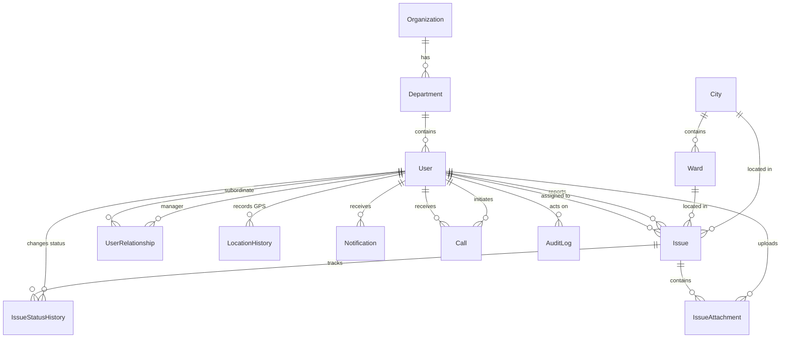

# Database Schema Reference

**Database Engine:** PostgreSQL (Supabase Hosted)  
**ORM:** Prisma ORM v5 (`apps/api/prisma/schema.prisma`)  
**Connection Architecture:**
- `DATABASE_URL`: Transaction/Session connection pooling URL.
- `DIRECT_URL`: Direct connection URL used for Prisma schema migrations.

---

## 1. Entity Relationship Diagram

---

## 2. Models & Field Definitions

### 2.1 `User`
Primary identity and profile table synchronized with Supabase Auth.
- `id` (String, `@id @default(uuid())`): Matches Supabase Auth `auth.users.id`.
- `employeeId` (String, `@unique`, Optional): Unique institutional ID.
- `name` (String): Full display name.
- `email` (String, `@unique`): User email address.
- `phone` (String, Optional): Phone number.
- `passwordHash` (String): Stored password hash (deprecated in favor of Supabase Auth).
- `roles` (`Role[]`, `@default([CITIZEN])`): Array of enum roles (`CITIZEN`, `STAFF`, `SUPERVISOR`, `ADMIN`).
- `designations` (`String[]`, `@default([])`): Array of specific functional titles (`STUDENT`, `COORDINATOR`, `FACULTY`, `MANAGER`, `INTERN`, `CORE`).
- `departmentId` (String, Optional, FK -> `Department.id`).
- `profilePhotoUrl` (String, Optional).
- `status` (`UserStatus`, `@default(OFFLINE)`): `ONLINE`, `AVAILABLE`, `BUSY`, `ON_TASK`, `ON_BREAK`, `OFFLINE`, `EMERGENCY`.
- `isActive` (Boolean, `@default(true)`).
- `lastLoginAt` (DateTime, Optional).
- `createdAt`, `updatedAt` (DateTime).

### 2.2 `UserRelationship`
Enforces direct reporting hierarchy across staff and supervisors.
- `id` (String, `@id @default(uuid())`).
- `managerUserId` (String, FK -> `User.id`).
- `subordinateUserId` (String, FK -> `User.id`).
- `relationshipType` (String): e.g., `'DIRECT_REPORT'`.
- `createdAt` (DateTime).
- **Constraints:** `@@unique([managerUserId, subordinateUserId])`.

### 2.3 `Issue`
Central ticket model representing both civic incidents and assigned operational tasks.
- `id` (String, `@id @default(uuid())`).
- `issueNumber` (String, `@unique @default(cuid())`): Human-readable tracking identifier.
- `reportedById` (String, FK -> `User.id`).
- `assignedToId` (String, Optional, FK -> `User.id`).
- `cityId` (String, Optional, FK -> `City.id`).
- `wardId` (String, Optional, FK -> `Ward.id`).
- `title` (String): Brief summary.
- `description` (String, Optional): Detailed issue report.
- `priority` (`Priority`, `@default(MEDIUM)`): `LOW`, `MEDIUM`, `HIGH`, `CRITICAL`.
- `status` (`IssueStatus`, `@default(REPORTED)`): Current ticket lifecycle phase.
- `category` (String, Optional): e.g. `'Infrastructure'`, `'Plumbing'`, `'Electrical'`.
- `type` (`IssueType`, `@default(ISSUE)`): Enum `ISSUE` (civic incident) or `TASK` (internal task).
- `restrictToRole` (`Role`, Optional): Restricts handling to a specific role.
- `locationLat` (Float, Optional): WGS-84 latitude coordinate.
- `locationLng` (Float, Optional): WGS-84 longitude coordinate.
- `address` (String, Optional): Physical address/location text.
- `deadline` (DateTime, Optional).
- `startedAt`, `reportedAt`, `acceptedAt`, `resolvedAt`, `verifiedAt`, `closedAt` (DateTime, Optional).
- `createdAt`, `updatedAt` (DateTime).

### 2.4 `IssueStatusHistory`
Audit record capturing chronological state transitions.
- `id` (String, `@id @default(uuid())`).
- `issueId` (String, FK -> `Issue.id`).
- `changedById` (String, FK -> `User.id`).
- `oldStatus` (`IssueStatus`, Optional).
- `newStatus` (`IssueStatus`).
- `remarks` (String, Optional).
- `locationLat`, `locationLng` (Float, Optional).
- `createdAt` (DateTime, `@default(now())`).

### 2.5 `IssueAttachment`
File attachments (photos, documents) associated with an issue.
- `id` (String, `@id @default(uuid())`).
- `issueId` (String, FK -> `Issue.id`).
- `uploadedById` (String, FK -> `User.id`).
- `fileUrl` (String): Relative URL (e.g., `/uploads/issues/<id>/filename.jpg`).
- `fileType` (String, Optional): Extension (e.g. `jpg`, `png`).
- `mimeType` (String, Optional): e.g. `image/jpeg`.
- `fileSize` (BigInt, Optional): Size in bytes.
- `createdAt` (DateTime, `@default(now())`).

### 2.6 `LocationHistory`
Geospatial GPS telemetry breadcrumb log.
- `id` (String, `@id @default(uuid())`).
- `userId` (String, FK -> `User.id`).
- `latitude` (Float), `longitude` (Float).
- `accuracy` (Float, Optional): Accuracy radius in meters.
- `recordedAt` (DateTime, `@default(now())`).

### 2.7 `Notification`
In-app notification records.
- `id` (String, `@id @default(uuid())`).
- `recipientId` (String, FK -> `User.id`).
- `type` (String): e.g., `'ISSUE_ASSIGNED'`, `'ESCALATION'`.
- `title` (String), `message` (String).
- `referenceType` (String, Optional): e.g., `'ISSUE'`.
- `referenceId` (String, Optional): Target entity ID.
- `isRead` (Boolean, `@default(false)`).
- `createdAt` (DateTime, `@default(now())`), `readAt` (DateTime, Optional).

### 2.8 `Call`
Session records for peer-to-peer WebRTC voice/video calls.
- `id` (String, `@id @default(uuid())`).
- `initiatedById` (String, FK -> `User.id`).
- `recipientId` (String, FK -> `User.id`).
- `callType` (String): `'audio'` or `'video'`.
- `status` (`CallStatus`, `@default(RINGING)`): `RINGING`, `ACCEPTED`, `REJECTED`, `MISSED`, `ENDED`, `FAILED`.
- `startedAt`, `endedAt` (DateTime, Optional).
- `durationSeconds` (Int, Optional).
- `createdAt` (DateTime, `@default(now())`).

### 2.9 `AuditLog`
System-wide audit trail for sensitive actions and state modifications.
- `id` (String, `@id @default(uuid())`).
- `action` (String): e.g. `'ISSUE_CREATED'`, `'STATUS_CHANGED'`, `'USER_LOGIN'`.
- `entityType` (String): e.g. `'ISSUE'`, `'USER'`.
- `entityId` (String): Identifier of the affected record.
- `actorId` (String, Optional, FK -> `User.id`).
- `oldValues`, `newValues` (Json, Optional): State snapshots before and after update.
- `ipAddress`, `userAgent` (String, Optional).
- `createdAt` (DateTime, `@default(now())`).

---

## 3. Enums

| Enum | Allowed Values |
| :--- | :--- |
| `Role` | `CITIZEN`, `STAFF`, `SUPERVISOR`, `ADMIN` |
| `UserStatus` | `ONLINE`, `AVAILABLE`, `BUSY`, `ON_TASK`, `ON_BREAK`, `OFFLINE`, `EMERGENCY` |
| `Priority` | `LOW`, `MEDIUM`, `HIGH`, `CRITICAL` |
| `IssueStatus` | `REPORTED`, `RECEIVED`, `ASSIGNED`, `ACCEPTED`, `IN_PROGRESS`, `ESCALATED`, `RESOLVED`, `VERIFIED`, `CLOSED`, `REJECTED` |
| `IssueType` | `ISSUE`, `TASK` |
| `CallStatus` | `RINGING`, `ACCEPTED`, `REJECTED`, `MISSED`, `ENDED`, `FAILED` |
