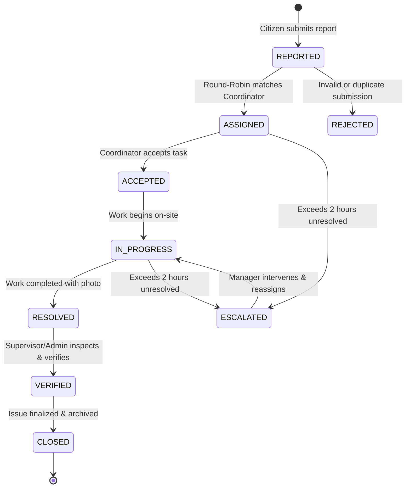
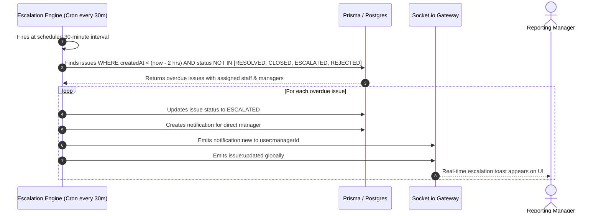

# End-to-End Workflows

This document details the critical user and system workflows across the application lifecycle.

---

## 1. Workflow: Complete Incident Lifecycle (Report to Verification)



### Steps & State Changes

1. **Step 1: Incident Creation (`REPORTED` / `ASSIGNED`)**
   - **Trigger:** Citizen opens `/report`, captures device GPS coordinates, enters title and description, and optionally attaches a photo.
   - **System Logic:** Backend checks for active `STAFF` with `COORDINATOR` designation. Assigns the next in round-robin order and marks status `ASSIGNED`. If no coordinator exists, status is `REPORTED`.
   - **Side Effects:** Emits `issue:new` via WebSocket; pushes notification to coordinator.

2. **Step 2: Task Acceptance (`ACCEPTED`)**
   - **Trigger:** Assigned coordinator receives notification and clicks "Accept".
   - **System Logic:** `PATCH /issues/:id/status` `{ status: "ACCEPTED" }`. Updates `acceptedAt = now()`.
   - **Side Effects:** Emits `issue:updated`.

3. **Step 3: On-Site Execution (`IN_PROGRESS`)**
   - **Trigger:** Coordinator begins field work and updates status to `IN_PROGRESS`.
   - **Side Effects:** Emits `issue:updated`.

4. **Step 4: Resolution Submission (`RESOLVED`)**
   - **Trigger:** Coordinator completes work, uploads resolution photo via `POST /issues/:id/attachments`, and marks status `RESOLVED`.
   - **System Logic:** Updates `resolvedAt = now()`.
   - **Side Effects:** Emits `issue:updated`.

5. **Step 5: Supervisory Verification (`VERIFIED`)**
   - **Trigger:** Supervisor or Admin reviews the resolution photo and marks the ticket `VERIFIED`.
   - **Permission Check:** If requester is not `SUPERVISOR` or `ADMIN`, request is rejected with `403 Forbidden`.
   - **System Logic:** Updates `verifiedAt = now()`.
   - **Side Effects:** Emits `issue:updated`.

6. **Step 6: Final Closure (`CLOSED`)**
   - **Trigger:** Issue is archived and marked `CLOSED`.
   - **System Logic:** Updates `closedAt = now()`.

---

## 2. Workflow: Background 2-Hour SLA Escalation



---

## 3. Workflow: Real-Time Field Personnel Tracking

1. **Activation:** Field staff member logs into web application.
2. **Geolocation Subscription:** Next.js application subscribes to `navigator.geolocation.watchPosition`.
3. **Emit Telemetry:** Browser continuously emits Socket.io event:
   ```json
   "location:update": { "lat": 28.6139, "lng": 77.2090, "accuracy": 5 }
   ```
4. **Relay & Storage:**
   - Server relays coordinates to `managers_of:<userId>` and `all_locations`.
   - Server writes a historical record to `LocationHistory` table.
5. **Visualization:** Supervisors on `/` or `/map` see the staff marker update in real-time on the MapLibre canvas without page reloads.

---

## 4. Workflow: WebRTC Encrypted Voice/Video Calling

1. **Initiate:** User clicks "Call" or "Video Call" on a team member in `/team` or `/calls`.
2. **Setup Call Record:** Web client calls `POST /calls/initiate`. Backend creates a `Call` row with `status: RINGING`.
3. **Ring Recipient:** Backend emits `call:incoming` to `user:<recipientId>`.
4. **Acceptance:** Recipient clicks "Accept". Recipient's browser emits `call:accept`.
5. **Signaling Exchange:** Both browsers generate local SDP offers/answers and ICE candidates, streaming them through `call:signal` over Socket.io.
6. **P2P Audio/Video Stream:** Once candidates match via Google STUN, audio/video media streams peer-to-peer directly between browsers.
7. **Termination:** Either party clicks "End Call". The browser calls `PATCH /calls/:id/status` `{ status: "ENDED" }`, closes media tracks, and resets UI state.
